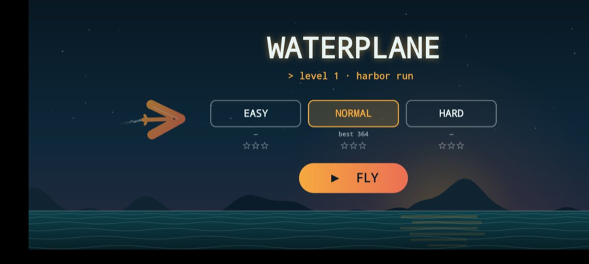
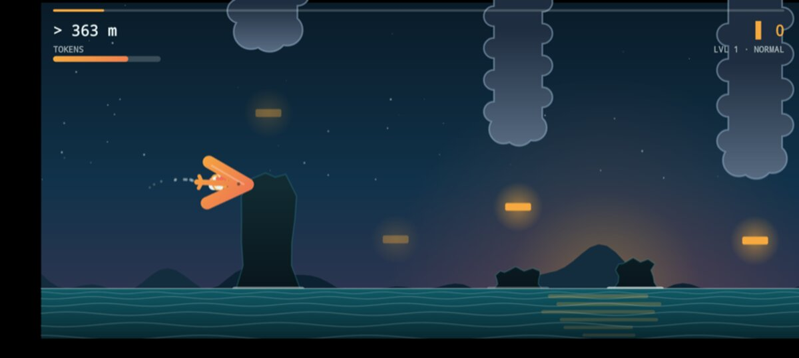

# Waterplane: Harbor Run

A small Android side-scroller in which you fly the [waterplane](https://github.com/waterplane-dev) logo through storm clouds, rock spires, lighthouses and reefs.

It was built from a phone, start to finish: one prompt sent through waterplane to Claude Code running on a desktop, then one follow-up to test it on an emulator.

<p>
  
  
</p>

## How to play

- **Hold** to climb. Climbing burns **TOKENS**.
- **Release** to glide.
- **Skim the water gently** to refill tokens. Hit it too steep and you sink.
- Grab the blinking amber cursors for tokens and score.
- Three difficulties: Easy, Normal and Hard. They change speed, gap size, how fast tokens burn and how steep a water landing you survive. Level 1 is "Harbor Run"; its 1–3 stars depend on how many cursors you collect.

## Build

No Gradle needed. You need Android SDK build-tools 35, platform 35 and a JDK 11 or newer.

```sh
./build.sh   # → build/waterplane-game-<version>.apk
```

The APK is signed with your local debug key (`~/.android/debug.keystore`, created if missing).

The whole game is two Java files using a plain `Canvas`: `src/dev/waterplane/game/GameView.java` and `MainActivity.java`.

## License

MIT
